# Отчёт о самостоятельной работе № 2

## Организация работы с репозиторием проекта и распределение ответственности в Git

**Команда:** «Не баг, а фича»  
**Бригада:** № 1  
**Дисциплина:** «Введение в профессиональную деятельность»  
**Дата:** 7 октября 2026 года

## 1. GitHub-аккаунты участников команды

| Участник | Роль | GitHub |
| --- | --- | --- |
| Двойных Никита Константинович | Лидер команды | [karasik115](https://github.com/karasik115) |
| Алиева София Эльдаровна | Менеджер | [soniikaka](https://github.com/soniikaka) |
| Аванесова Анастасия Денисовна | Дизайнер UI/UX | [NASSS1E](https://github.com/NASSS1E) |
| Гришин Андрей Александрович | Программист | [1Andrey0](https://github.com/1Andrey0) |
| Аляпкин Никита Игоревич | Специалист по БД | [N1kr0man](https://github.com/N1kr0man) |
| Шушкин Артем Олегович | Тестировщик QA | [artiomshushkin-lang](https://github.com/artiomshushkin-lang) |

Все шесть участников команды зарегистрированы на GitHub. Логины приведены в таблице. Наличие аккаунтов подтверждается списком авторов личных Pull Request.

## 2. Ссылка на командный репозиторий

Создан репозиторий [team-ne-bag-a-ficha-project](https://github.com/karasik115/team-ne-bag-a-ficha-project) в аккаунте лидера команды `karasik115`. Название соответствует формату `team-<название_команды>-project`; название команды передано латиницей как `ne-bag-a-ficha`.

Репозиторий приватный.

## 3. Структура репозитория

Репозиторий содержит восемь папок практических работ. В каждой папке находится `report.md`; в работах № 1–2 предусмотрены `assets/`, в работах № 3–8 `src/`. Материалы работ № 3–8 пока отсутствуют.

Общая документация команды:

- [team-contract.md](../../docs/team-contract.md): правила взаимодействия;
- [roles-and-responsibilities.md](../../docs/roles-and-responsibilities.md): роли и обязанности участников;
- [raci-matrix.md](../../docs/raci-matrix.md): распределение ответственности.

Назначение проекта, состав команды и ссылки на материалы приведены в [README.md](../../README.md). Скрипт проверки структуры находится в `scripts/check_structure.py`.

## 4. Распределение ответственности за работу в Git

| Участник | Роль | Обязанности в Git |
| --- | --- | --- |
| Двойных Никита Константинович | Лидер команды | Создание и настройка репозитория, контроль структуры, проверка Pull Request, принятие результата и слияние веток. |
| Алиева София Эльдаровна | Менеджер | Координация сроков и коммуникации, поддержание README и отчётных материалов, контроль готовности документов. |
| Аванесова Анастасия Денисовна | Дизайнер UI/UX | Оформление документов команды и скриншотов СР2, размещение материалов в assets второй работы. |
| Гришин Андрей Александрович | Программист | Поддержание вспомогательного скрипта проверки структуры, описание его запуска и результатов проверки. |
| Аляпкин Никита Игоревич | Специалист по БД | Подготовка резервной копии репозитория и описание порядка обновления и восстановления материалов. |
| Шушкин Артем Олегович | Тестировщик QA | Ведение проверок и результатов тестирования, фиксация ошибок и скриншотов, проверка изменений и материалов перед сдачей. |

| Задача | Лидер Никита Д. | Менеджер София А. | Дизайнер Анастасия А. | Программист Андрей Г. | Специалист по БД Никита А. | Тестировщик Артем Ш. |
| --- | --- | --- | --- | --- | --- | --- |
| Создание и настройка репозитория | R/A | C | I | I | I | I |
| Поддержание структуры папок и файлов | R/A | R | R | R | R | R |
| Написание отчётов по практическим работам | R/A | R | R | R | R | R |
| Внесение коммитов с осмысленными сообщениями | R/A | R | R | R | R | R |
| Проверка Pull Request | R/A | C | C | C | C | C |
| Слияние веток | R/A | I | I | I | I | I |
| Резервное копирование и поддержание актуальности | R/A | R | R | R | R | R |

В матрице R обозначает исполнителя, A ответственного за результат, C консультируемого, I информируемого.

Каждый участник выполняет коммиты за собственные изменения. Лидер проверяет Pull Request и выполняет слияние. Изменения самого лидера должен проверить другой участник. Подробная [матрица RACI](../../docs/raci-matrix.md) содержит распределение задач по формированию команды и работе с Git.

## 5. История коммитов и авторы изменений

Все шесть участников внесли личные изменения в `docs/roles-and-responsibilities.md`. По автору, содержанию коммита и связанному Pull Request можно проверить личный вклад.

| Участник, автор | Личный коммит | Результат |
| --- | --- | --- |
| Никита Двойных, `karasik115` | [f672602](https://github.com/karasik115/team-ne-bag-a-ficha-project/pull/6/commits/f672602774dab5bf8016196c6e09bdc7b05d4ba1) | Добавлена роль лидера команды. |
| София Алиева, `soniikaka` | [f9ceee8](https://github.com/karasik115/team-ne-bag-a-ficha-project/pull/5/commits/f9ceee85a21231ba94e785316409d44ecd46c9f8) | Добавлена роль менеджера, уточнено имя участницы. |
| Анастасия Аванесова, `NASSS1E` | [eb4e3ee](https://github.com/karasik115/team-ne-bag-a-ficha-project/pull/2/commits/eb4e3eedf3b9ed50890165e21b31c2e28c6f73b6) | Внесена роль дизайнера UI/UX. |
| Андрей Гришин, `1Andrey0` | [ccb9ad1](https://github.com/karasik115/team-ne-bag-a-ficha-project/pull/3/commits/ccb9ad16d8c7ec5961c5bd470752412c130e4b13) | Добавлена роль программиста. |
| Никита Аляпкин, `N1kr0man` | [2f8dae9](https://github.com/karasik115/team-ne-bag-a-ficha-project/pull/7/commits/2f8dae978878a693982dfacfa0ff559330f72ddb) | Добавлена роль специалиста по БД. |
| Артем Шушкин, `artiomshushkin-lang` | [8734f7f](https://github.com/karasik115/team-ne-bag-a-ficha-project/pull/4/commits/8734f7f1a3235507cd3b64692208068716e1990f) | Добавлена роль тестировщика QA. |

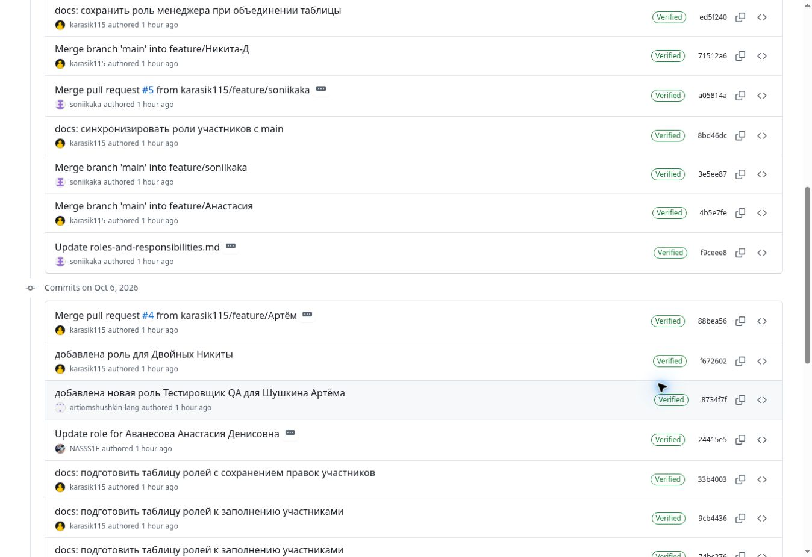

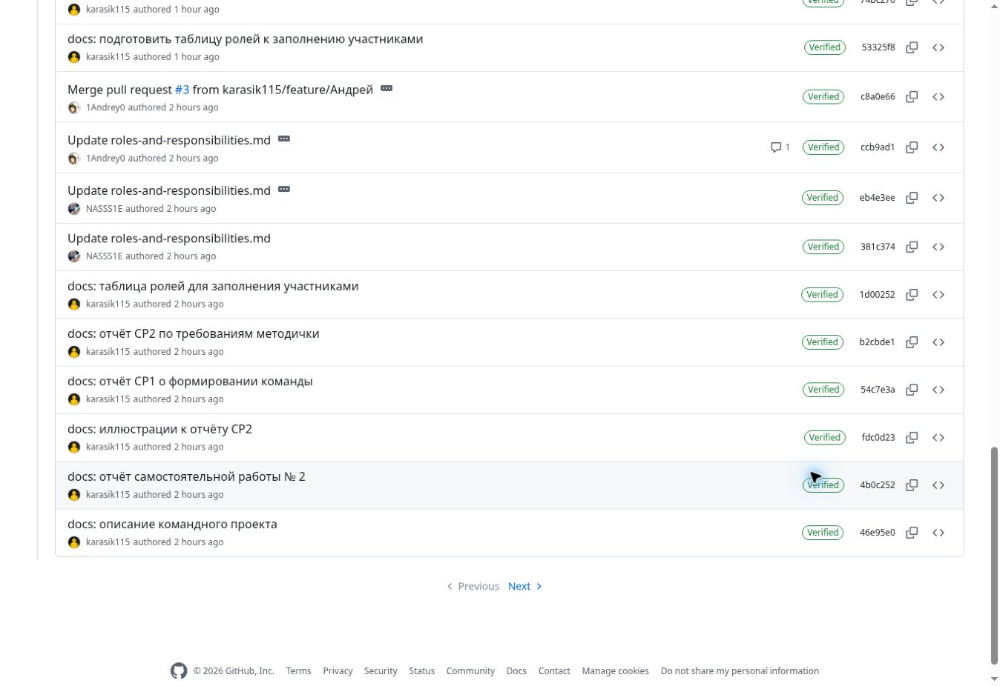

## 6. Ветки, Pull Request и ревью

Каждый участник создал отдельную ветку. В основной ветке `main` хранится общий результат. В файле ролей во всех шести рабочих ветках приведена одна актуальная таблица участников без пустых ролей и повторяющихся строк.

| Участник | Текущая рабочая ветка | Личный Pull Request | Состояние |
| --- | --- | --- | --- |
| Никита Двойных | `feature/Никита-Д` | [№ 6](https://github.com/karasik115/team-ne-bag-a-ficha-project/pull/6) | Объединён с main. |
| София Алиева | `feature/Соня` | [№ 5](https://github.com/karasik115/team-ne-bag-a-ficha-project/pull/5) | Объединён с main. |
| Анастасия Аванесова | `feature/Анастасия` | [№ 2](https://github.com/karasik115/team-ne-bag-a-ficha-project/pull/2) | Получено ревью, объединён с main. |
| Андрей Гришин | `feature/Андрей` | [№ 3](https://github.com/karasik115/team-ne-bag-a-ficha-project/pull/3) | Объединён с main. |
| Никита Аляпкин | `feature/Никита-А` | [№ 7](https://github.com/karasik115/team-ne-bag-a-ficha-project/pull/7) | Объединён с main. |
| Артем Шушкин | `feature/Артём` | [№ 4](https://github.com/karasik115/team-ne-bag-a-ficha-project/pull/4) | Объединён с main. |

PR Софии № 5 был создан из `feature/soniikaka`. После слияния эта ветка удалена; текущая рабочая ветка участницы называется `feature/Соня`. Историческое название в закрытом PR сохранено GitHub.

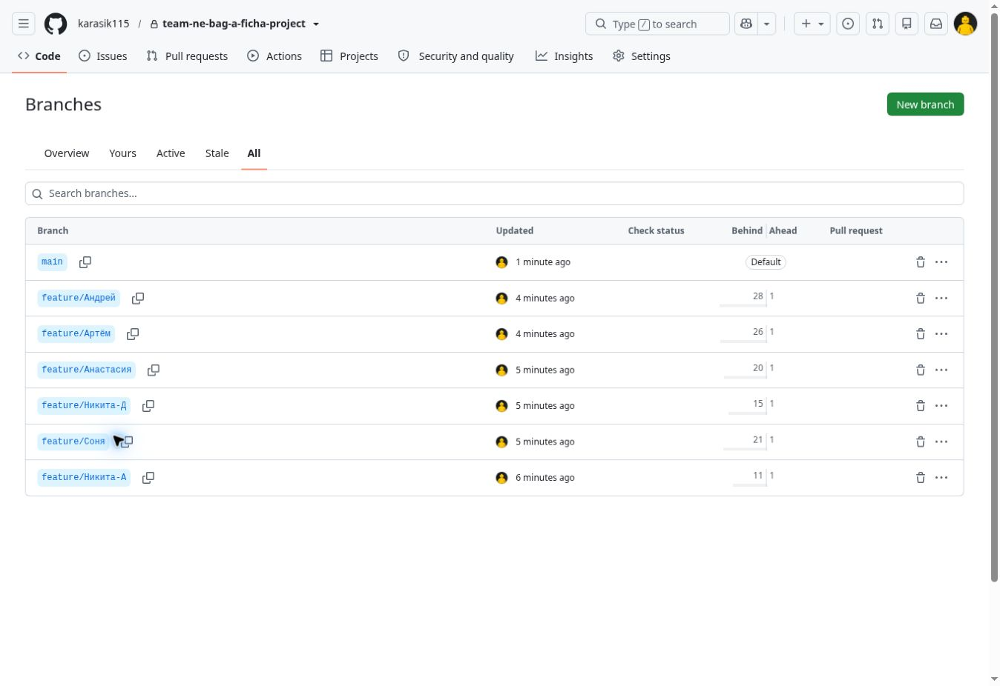

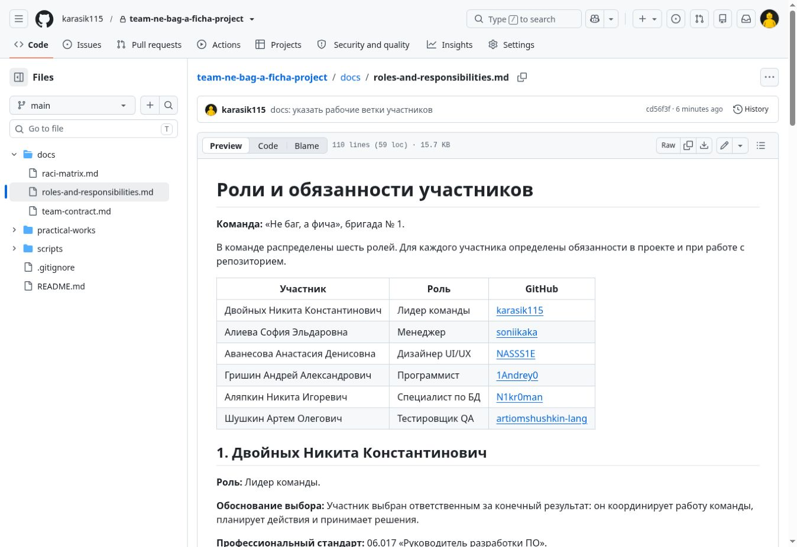

### Личные Pull Request участников

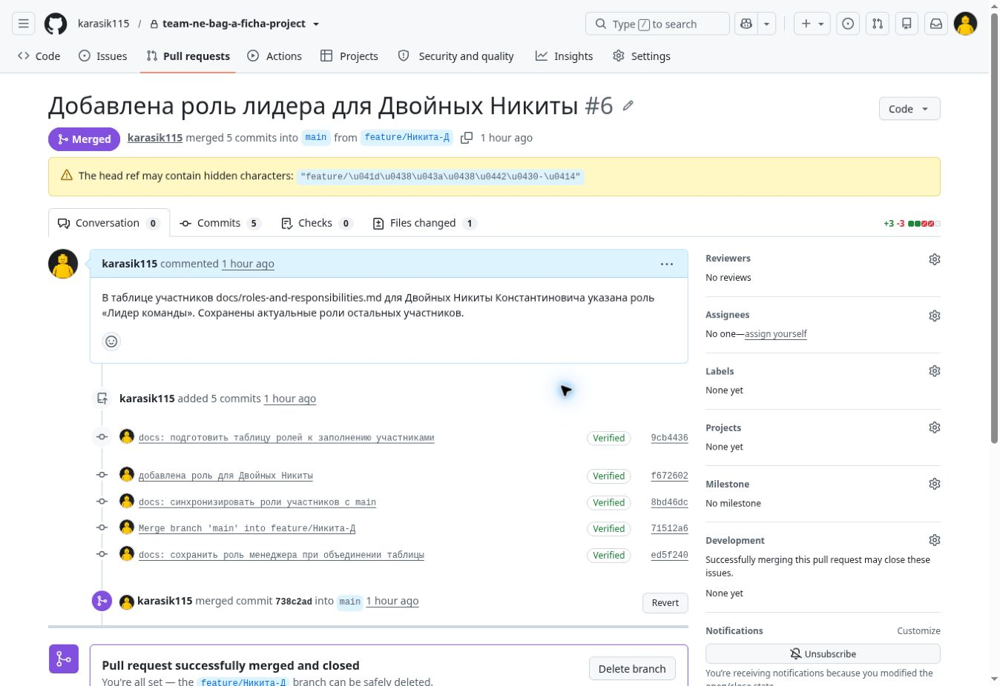

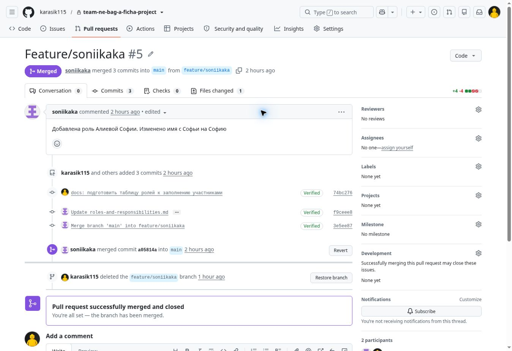

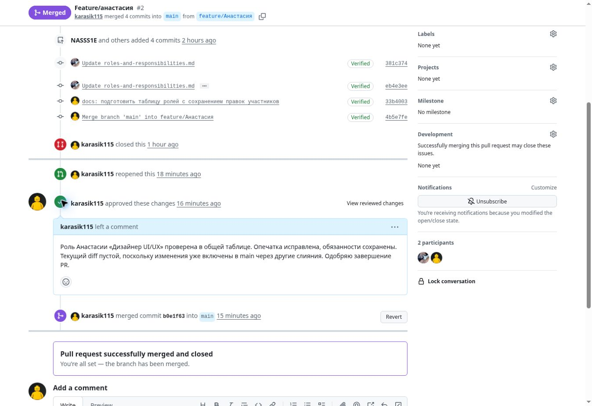

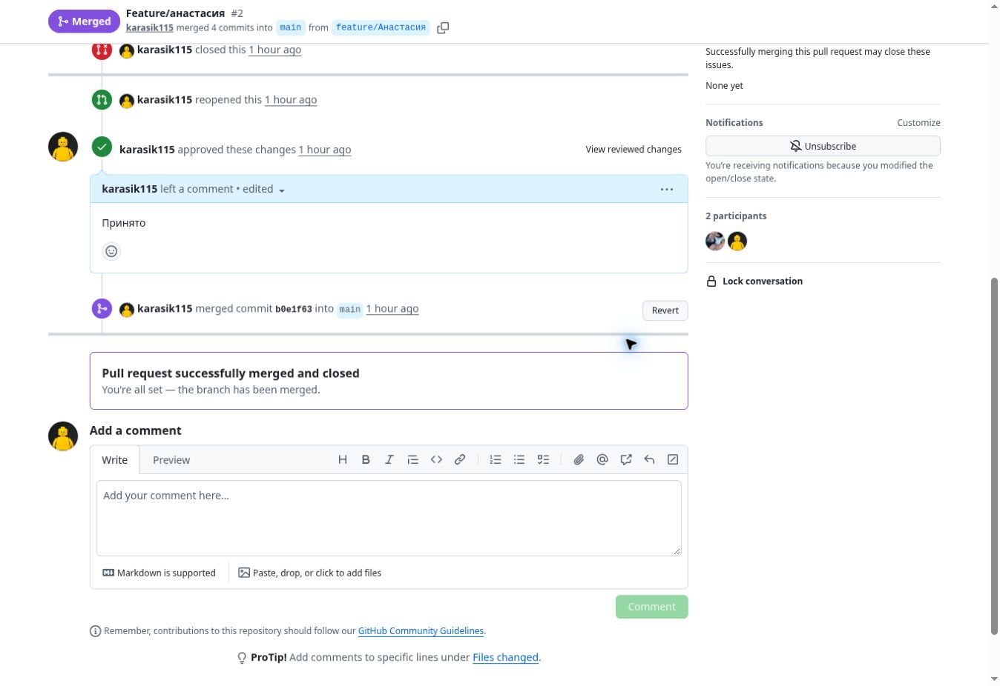

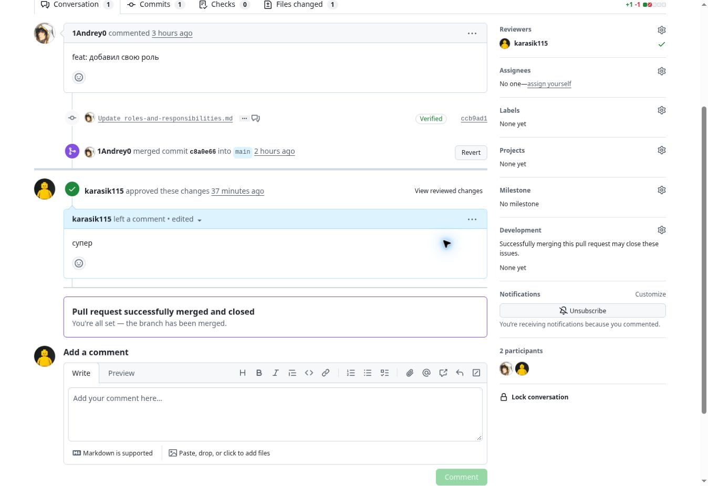

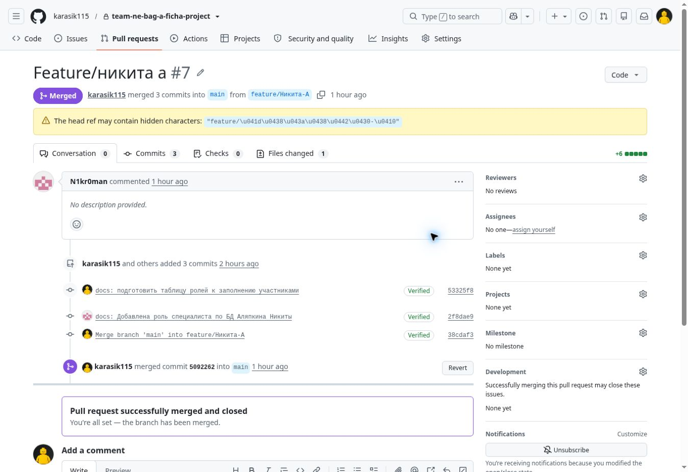

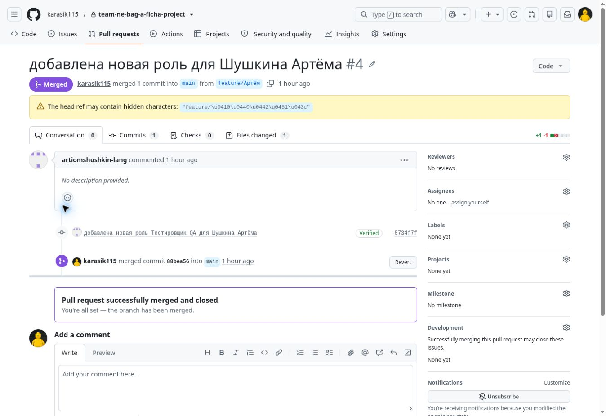

### Проверка изменений

PR Анастасии № 2 получил одобрение `karasik115` перед окончательным слиянием. В процессе проверки исправлена опечатка в названии роли, устранён конфликт. Ревью и результат слияния показаны на скриншоте PR № 2.

У PR № 3, № 4, № 5, № 6 и № 7 на момент подготовки отчёта опубликованные ревью отсутствуют. Для завершения личного цикла по пункту 5 методички требуется проверка другим участником. PR лидера № 6 должен проверить один из остальных участников команды.

### Завершение личного цикла работы с Git

GitHub подтверждает наличие отдельных веток, личных коммитов, созданных Pull Request и их слияние в main. Клонирование репозитория на личный компьютер и выполнение отдельного локального `push` по скриншотам GitHub не подтверждаются. Каждый участник должен выполнить или подтвердить эти действия на своём компьютере, сохранить актуальную локальную копию и получить недостающее ревью. Следующие изменения следует проверять до слияния.

## 7. Вывод

Единый репозиторий позволяет хранить результаты всех этапов в понятной структуре. Документы команды связывают задачи с ролями и ответственностью, отдельные ветки позволяют готовить изменения, а коммиты и Pull Request сохраняют историю их выполнения. История изменений позволяет определить личный вклад участников и проверить результат совместной работы.

## Контрольные вопросы

### 1. Что такое репозиторий и для чего он нужен?

Репозиторий хранит файлы проекта и историю их изменений. Он нужен для совместной работы, сохранения версий, проверки результатов и восстановления предыдущих состояний.

### 2. Какие преимущества даёт использование Git при командной разработке?

Git позволяет участникам работать в отдельных ветках, фиксировать изменения, сравнивать версии и объединять результаты. История коммитов помогает увидеть, кто и какие изменения внёс.

### 3. Что такое коммит и каким правилам должно соответствовать сообщение коммита?

Коммит фиксирует состояние отслеживаемых файлов и сведения об изменении. Сообщение должно кратко и понятно описывать его смысл; например, «docs: добавить правила командной работы». Несвязанные изменения лучше разделять на отдельные коммиты.

### 4. В чём разница между веткой и основной веткой main/master?

Ветка представляет отдельную линию изменений. Участник выполняет задачу в своей ветке, а основная ветка хранит объединённый результат работы команды. Перед переносом изменений в основную ветку их проверяют.

### 5. Что такое Pull Request и как он связан с распределением ответственности?

Pull Request является запросом на перенос изменений из одной ветки в другую. Автор отвечает за подготовку изменений, рецензент проверяет их, а лидер принимает результат и выполняет слияние в соответствии с распределением обязанностей.

### 6. Как через историю коммитов можно определить вклад каждого участника команды?

В истории видны автор, время, сообщение и изменения каждого коммита. По содержанию изменений и связанным Pull Request можно определить выполненные задачи. Количество коммитов само по себе не показывает качество или объём вклада.

### 7. Почему перед началом работы требуется регистрация на GitHub?

Учётная запись нужна для доступа к командному репозиторию, отправки изменений, создания Pull Request и участия в обсуждениях. Логины позволяют связать действия на платформе с участниками команды.
