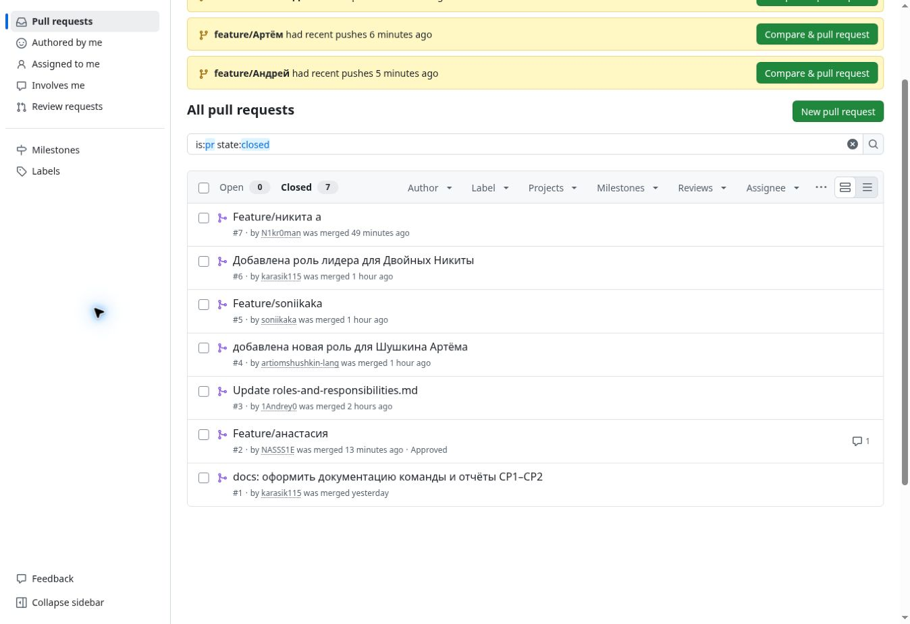

# Отчёт о самостоятельной работе № 2

## Организация работы с репозиторием проекта и распределение ответственности в Git

**Команда:** «Не баг, а фича»  
**Бригада:** № 1  
**Дисциплина:** «Введение в профессиональную деятельность»  
**Дата:** 5 октября 2026 года

## Цель работы

Сформировать базовые навыки работы с репозиторием проекта, освоить принципы хранения и организации материалов, а также закрепить распределение ответственности через практическую работу в системе контроля версий.

## 1. Регистрация участников на GitHub

| Участник | Роль | GitHub |
| --- | --- | --- |
| Двойных Никита Константинович | Лидер команды | [karasik115](https://github.com/karasik115) |
| Алиева Софья Эльдаровна | Менеджер | [soniikaka](https://github.com/soniikaka) |
| Аванесова Анастасия Денисовна | Дизайнер UI/UX | [NASSS1E](https://github.com/NASSS1E) |
| Гришин Андрей Александрович | Программист | [1Andrey0](https://github.com/1Andrey0) |
| Аляпкин Никита Игоревич | Специалист по БД | [N1kr0man](https://github.com/N1kr0man) |
| Шушкин Артем Олегович | Тестировщик QA | [artiomshushkin-lang](https://github.com/artiomshushkin-lang) |

Все шесть участников команды имеют аккаунты GitHub. 5 октября 2026 года приглашения отправлены всем пяти участникам команды. По состоянию на 22:25 по московскому времени доступ получили Андрей (`1Andrey0`), Анастасия (`NASSS1E`) и Софья (`soniikaka`). Артем (`artiomshushkin-lang`) и Никита А. (`N1kr0man`) ещё ожидают принятия приглашений.



## 2. Создание командного репозитория

Создан репозиторий [team-ne-bag-a-ficha-project](https://github.com/karasik115/team-ne-bag-a-ficha-project) в аккаунте лидера команды `karasik115`. Название соответствует формату `team-<название_команды>-project`; название команды передано латиницей как `ne-bag-a-ficha`.

Репозиторий приватный. Для проверки работы преподавателю необходимо предоставить доступ.

## 3. Структура репозитория и документация

Сохранены все восемь папок практических работ. Для работ № 1 и № 2 созданы `assets/`, для работ № 3–8 `src/`. Работы № 3–8 содержат только файлы-заготовки и пустые папки по образцу СР2. В каждой работе есть `report.md`. Общие документы находятся в `docs/`, скрипт проверки в `scripts/`, служебные файлы исключаются через `.gitignore`.

В репозитории размещены:

- состав из шести участников и отдельные роли лидера и менеджера;
- правила Telegram, Discord, ежедневных сообщений, времени ответа и разрешения разногласий;
- обоснования выбора ролей, профессиональные стандарты, трудовые функции и эссе;
- матрица RACI для командных задач и работы с Git;
- вывод и ответы на контрольные вопросы СР1.

### Папки и файлы проекта


## 4. Распределение ответственности за работу в Git

| Участник | Роль | Обязанности в Git |
| --- | --- | --- |
| Двойных Никита Константинович | Лидер команды | Создание и настройка репозитория, контроль структуры, проверка Pull Request, принятие результата и слияние веток. |
| Алиева Софья Эльдаровна | Менеджер | Координация сроков и коммуникации, поддержание README и отчётных материалов, контроль готовности документов. |
| Аванесова Анастасия Денисовна | Дизайнер UI/UX | Оформление документов команды и скриншотов СР2, размещение материалов в assets второй работы. |
| Гришин Андрей Александрович | Программист | Поддержание вспомогательного скрипта проверки структуры, описание его запуска и результатов проверки. |
| Аляпкин Никита Игоревич | Специалист по БД | Подготовка резервной копии репозитория и описание порядка обновления и восстановления материалов. |
| Шушкин Артем Олегович | Тестировщик QA | Ведение проверок и результатов тестирования, фиксация ошибок и скриншотов, проверка изменений и материалов перед сдачей. |

| Задача | Лидер<br>Никита Д. | Менеджер<br>Софья А. | Дизайнер<br>Анастасия А. | Программист<br>Андрей Г. | Специалист по БД<br>Никита А. | Тестировщик<br>Артем Ш. |
| --- | --- | --- | --- | --- | --- | --- |
| Создание и настройка репозитория | R/A | C | I | I | I | I |
| Поддержание структуры папок и файлов | R/A | R | R | R | R | R |
| Написание отчётов по практическим работам | R/A | R | R | R | R | R |
| Внесение коммитов с осмысленными сообщениями | R/A | R | R | R | R | R |
| Проверка Pull Request | R/A | C | C | C | C | C |
| Слияние веток | R/A | I | I | I | I | I |
| Резервное копирование и поддержание актуальности | R/A | R | R | R | R | R |

Обязанности соответствуют семи пунктам методички. Каждый участник выполняет коммиты за собственные изменения. Лидер проверяет Pull Request и выполняет слияние. Изменения самого лидера должен проверить другой участник. Подробная [матрица RACI](../../docs/raci-matrix.md) содержит распределение задач по формированию команды и работе с Git.

## 5. Практическая работа с Git

Документация оформлена в ветке `role/team-leader` и объединена с `main` через Pull Request № 1.

### Действия каждого участника

| Участник | Ветка для работы | Первая задача по роли |
| --- | --- | --- |
| Двойных Никита Константинович | `role/team-leader` | Оформить документы команды и отчёт СР2, проверить структуру. |
| Алиева Софья Эльдаровна | `role/manager` | Уточнить правила обсуждения задач и соблюдения сроков в team-contract.md, дополнить отчёт СР2. |
| Аванесова Анастасия Денисовна | `role/designer` | Проверить оформление README и документов команды; внести исправление и описать его в своём PR. |
| Гришин Андрей Александрович | `role/programmer` | Проверить скрипт структуры, описать способ запуска и результат. |
| Аляпкин Никита Игоревич | `role/database-specialist` | Описать способ резервного копирования и восстановления материалов. |
| Шушкин Артем Олегович | `role/tester` | Проверить ссылки, структуру и полноту отчёта, зафиксировать найденные ошибки. |

Каждый участник выполняет полный цикл на своём компьютере: клонирование, рабочая ветка, изменение по своей роли, коммит, push, Pull Request, ревью другим участником и слияние. Названия веток в таблице используются при выполнении этих действий.

Для примера участник с ролью программиста выполняет:

```sh
git clone https://github.com/karasik115/team-ne-bag-a-ficha-project.git
cd team-ne-bag-a-ficha-project
git switch -c role/programmer
# Внести изменения в материалы своей роли.
git add practical-works/practical-work-02/report.md
git commit -m "docs: описать проверку структуры от роли программиста"
git push -u origin role/programmer
```

Если изменён другой файл, в `git add` нужно указать его фактический путь. Каждый участник использует собственную ветку из таблицы и свой аккаунт GitHub. Клонирование приватного репозитория требует предоставленного доступа и настройки аутентификации на своём компьютере.

После `push` участник создаёт Pull Request в `main`, описывает внесённые изменения, получает ревью другого участника и передаёт слияние лидеру. При повторной работе сначала обновляет `main`, затем создаёт новую ветку для следующей задачи либо продолжает ещё не объединённую ветку.

### История коммитов


История коммитов показывает изменения документации, сообщения и автора каждого коммита.

### Pull Request

Создан [Pull Request № 1](https://github.com/karasik115/team-ne-bag-a-ficha-project/pull/1) из ветки `role/team-leader` в `main`.


Pull Request № 1 объединён с `main`. Для дальнейших изменений участники создают свои Pull Request; перед слиянием их проверяет другой участник. Скриншоты обсуждения, замечаний и одобрения добавляются в отчёт после ревью.

## 6. Результаты и дальнейшие задачи

| Требование СР2 | Результат | Дальнейшие действия |
| --- | --- | --- |
| Регистрация всех участников | Логины всех шести участников указаны; доступ получили Андрей, Анастасия и Софья | Артему и Никите А. принять приглашения. |
| Создание командного репозитория | Выполнено | Обеспечить доступ преподавателю при сдаче. |
| Обязательная структура | Выполнено | Поддерживать её при следующих работах. |
| Документы и обязанности по ролям СР1 | Выполнено | Обновлять при согласованных изменениях. |
| Ветка, коммиты и PR лидера | Есть ветка role/team-leader, коммиты и объединённый PR № 1 | Выполнить локальную работу с Git и получить ревью другого участника перед следующим слиянием. |
| Клонирование репозитория | Каждый участник выполняет на своём компьютере | Клонировать приватный репозиторий под своим аккаунтом, если это ещё не сделано. |
| Личные ветки, коммиты и push остальных | Пока не отражены в GitHub | Каждому участнику отправить собственную ветку с изменением по роли. |
| Pull Request | PR № 1 с документацией объединён с main | Добавить личные Pull Request участников. |
| Ревью другим участником | В PR № 1 отсутствует | Получить ревью на личные PR до слияния; приложить скриншоты обсуждения и одобрения. |
| Скриншоты структуры, коммитов и PR | Добавлены | Дополнить после командной работы и ревью. |

### Проверка содержания итогового отчёта СР2

| Пункт методички | Раздел отчёта | Состояние |
| --- | --- | --- |
| Подтверждение регистрации: список логинов | 1 | Добавлены все шесть логинов. |
| Ссылка на командный репозиторий | 2 | Добавлена. |
| Скриншот структуры: дерево папок и файлов | 3 | Добавлен. |
| Распределение обязанностей с привязкой к ролям СР1 | 4 | Добавлены шесть ролей и семь обязанностей в Git. |
| Скриншоты истории коммитов с авторами | 5 | Добавлены; после личной работы участников нужно обновить. |
| Скриншоты Pull Request и процесса ревью | 5 | PR № 1 добавлен; скриншоты независимого ревью нужны после проверки участниками. |
| Краткий вывод о командной работе и вкладе | Краткий вывод | Добавлен. |

### Что осталось выполнить для завершения СР2

1. Артему и Никите А. принять приглашения в репозиторий.
2. Каждому участнику клонировать репозиторий на свой компьютер, создать рабочую ветку и внести изменение по своей роли из таблицы раздела 5.
3. Каждому сделать осмысленный коммит, выполнить push и открыть свой Pull Request в main.
4. Получить ревью другого участника, исправить замечания и передать слияние лидеру. Изменения лидера также проверяет другой участник.
5. После командной работы обновить скриншоты истории коммитов, Pull Request и ревью в assets/ второй работы и включить их в отчёт.
6. Лидеру проверить итоговую структуру и полноту отчёта, актуальность материалов и резервной копии, затем обеспечить преподавателю доступ к приватному репозиторию при сдаче.

Структуру можно проверить командой `python scripts/check_structure.py` из корня репозитория.

## Краткий вывод

Единый репозиторий позволяет хранить результаты всех этапов в понятной структуре. Документы команды связывают задачи с ролями и ответственностью, отдельные ветки позволяют готовить изменения, а коммиты и Pull Request сохраняют историю их выполнения. Чтобы история отражала вклад всей команды, каждому участнику необходимо вносить изменения из собственного аккаунта и участвовать в проверке работ других участников.

## Контрольные вопросы

### 1. Что такое репозиторий и для чего он нужен?

Репозиторий хранит файлы проекта и историю их изменений. Он нужен для совместной работы, сохранения версий, проверки результатов и восстановления предыдущих состояний.

### 2. Какие преимущества даёт использование Git при командной разработке?

Git позволяет участникам работать в отдельных ветках, фиксировать изменения, сравнивать версии и объединять результаты. История коммитов помогает увидеть, кто и какие изменения внёс.

### 3. Что такое коммит и каким правилам должно соответствовать сообщение коммита?

Коммит фиксирует состояние отслеживаемых файлов и сведения об изменении. Сообщение должно кратко и понятно описывать его смысл; например, «docs: добавить правила командной работы». Несвязанные изменения лучше разделять на отдельные коммиты.

### 4. В чём разница между веткой и основной веткой main/master?

Ветка представляет отдельную линию изменений. Участник выполняет задачу в своей ветке, а основная ветка хранит объединённый результат работы команды. Перед переносом изменений в основную ветку их проверяют.

### 5. Что такое Pull Request и как он связан с распределением ответственности?

Pull Request является запросом на перенос изменений из одной ветки в другую. Автор отвечает за подготовку изменений, рецензент проверяет их, а лидер принимает результат и выполняет слияние в соответствии с распределением обязанностей.

### 6. Как через историю коммитов можно определить вклад каждого участника команды?

В истории видны автор, время, сообщение и изменения каждого коммита. По содержанию изменений и связанным Pull Request можно определить выполненные задачи. Количество коммитов само по себе не показывает качество или объём вклада.

### 7. Почему перед началом работы требуется регистрация на GitHub?

Учётная запись нужна для доступа к командному репозиторию, отправки изменений, создания Pull Request и участия в обсуждениях. Логины позволяют связать действия на платформе с участниками команды.
