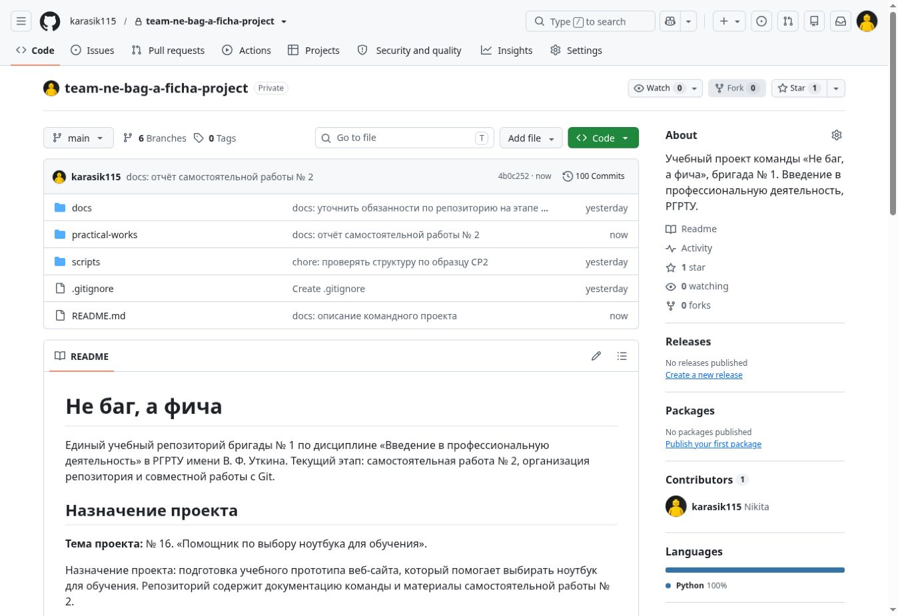
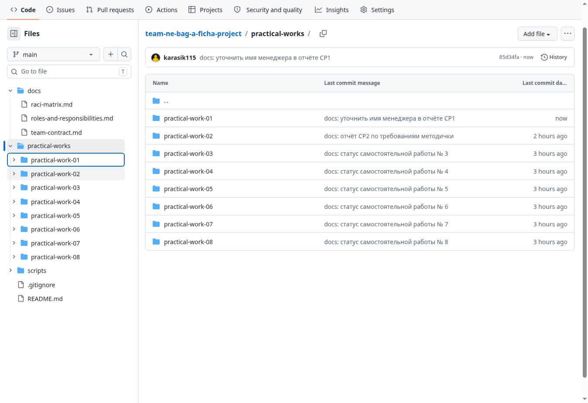
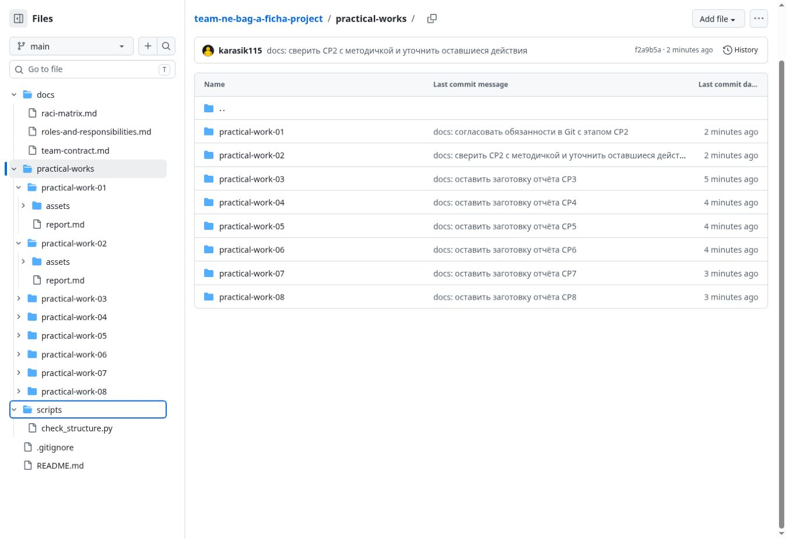
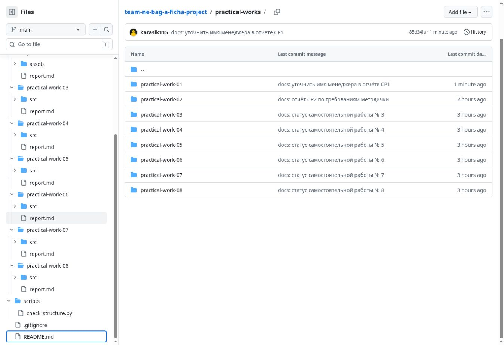
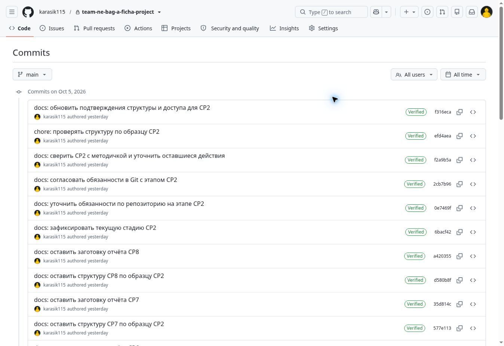
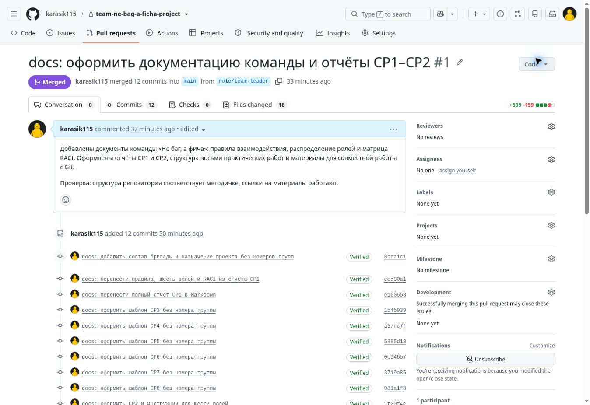

# Отчёт о самостоятельной работе № 2

## Организация работы с репозиторием проекта и распределение ответственности в Git

**Команда:** «Не баг, а фича»  
**Бригада:** № 1  
**Дисциплина:** «Введение в профессиональную деятельность»  
**Дата подготовки:** 5 октября 2026 года

Статус: организационная часть выполнена; личные действия пяти участников и независимое ревью требуют подтверждения. Этот отчёт не утверждает, что все участники уже зарегистрировались, клонировали репозиторий или внесли изменения.

## Цель работы

Сформировать базовые навыки работы с репозиторием проекта, освоить принципы хранения и организации материалов, а также закрепить распределение ответственности через практическую работу в системе контроля версий.

## 1. Регистрация участников на GitHub

| Участник | Роль | GitHub |
| --- | --- | --- |
| Двойных Никита Константинович | Лидер команды | [karasik115](https://github.com/karasik115) |
| Алиева Софья Эльдаровна | Менеджер | Логин не предоставлен |
| Аванесова Анастасия Денисовна | Дизайнер UI/UX | [NASSS1E](https://github.com/NASSS1E) |
| Гришин Андрей Александрович | Программист | [1Andrey0](https://github.com/1Andrey0) |
| Аляпкин Никита Игоревич | Специалист по БД | [N1kr0man](https://github.com/N1kr0man) |
| Шушкин Артем Олегович | Тестировщик QA | Логин не предоставлен |

Аккаунт лидера `karasik115` подтверждён созданием репозитория и выполненными коммитами. По предоставленному скриншоту добавлены и найдены в GitHub аккаунты дизайнера `NASSS1E`, программиста `1Andrey0` и специалиста по БД `N1kr0man`. Всем троим 5 октября 2026 года отправлены приглашения в приватный репозиторий. Статус приглашений на момент обновления: ожидают принятия (Pending Invite). После принятия участники смогут клонировать репозиторий и вносить изменения. Логины менеджера и тестировщика пока не предоставлены.

## 2. Создание командного репозитория

Создан репозиторий [team-ne-bag-a-ficha-project](https://github.com/karasik115/team-ne-bag-a-ficha-project) в аккаунте лидера команды `karasik115`. Название соответствует формату `team-<название_команды>-project`; название команды передано латиницей как `ne-bag-a-ficha`.

Репозиторий приватный. При сдаче преподавателю необходимо предоставить доступ либо отдельно согласовать публичное размещение.

## 3. Организация структуры и перенос результатов СР1

Сохранены все восемь папок практических работ. Для работ № 1 и № 2 созданы `assets/`, для работ № 3–8 `src/`. В каждой работе есть `report.md`. Общие документы находятся в `docs/`, скрипт проверки в `scripts/`, служебные файлы исключаются через `.gitignore`.

Из отчёта № 1 перенесены:

- состав из шести участников и отдельные роли лидера и менеджера;
- правила Telegram, Discord, ежедневных сообщений, времени ответа и разрешения разногласий;
- обоснования выбора ролей, профессиональные стандарты, трудовые функции и эссе;
- исходная матрица RACI без изменения букв ответственности;
- вывод и ответы на контрольные вопросы СР1 в отчёт первой работы.

Номера учебных групп удалены из актуальных текстовых файлов и описания репозитория. Исходный Word-документ не публикуется, чтобы не возвращать эти сведения в актуальные материалы. История предыдущих коммитов сохраняется.

### Подтверждение структуры









## 4. Распределение ответственности за работу в Git

| Участник | Роль | Обязанности в Git |
| --- | --- | --- |
| Двойных Никита Константинович | Лидер команды | Создание и настройка репозитория, контроль структуры, проверка Pull Request, принятие результата и слияние веток. |
| Алиева Софья Эльдаровна | Менеджер | Координация сроков и коммуникации, поддержание README и отчётных материалов, контроль готовности документов. |
| Аванесова Анастасия Денисовна | Дизайнер UI/UX | Оформление интерфейса и иллюстраций, размещение макетов и скриншотов в assets соответствующей работы. |
| Гришин Андрей Александрович | Программист | Размещение исходного кода в src, поддержание вспомогательных скриптов, исправление ошибок и описание технических изменений. |
| Аляпкин Никита Игоревич | Специалист по БД | Размещение схем и материалов по данным, подготовка резервных копий и проверка актуальности материалов своего раздела. |
| Шушкин Артем Олегович | Тестировщик QA | Ведение проверок и результатов тестирования, фиксация ошибок и скриншотов, проверка изменений и материалов перед сдачей. |

| Задача | Лидер<br>Никита Д. | Менеджер<br>Софья А. | Дизайнер<br>Анастасия А. | Программист<br>Андрей Г. | Специалист по БД<br>Никита А. | Тестировщик<br>Артем Ш. |
| --- | --- | --- | --- | --- | --- | --- |
| Создание и настройка репозитория | R/A | C | I | I | I | I |
| Поддержание структуры папок и файлов | R/A | R | R | R | R | R |
| Написание отчётов по практическим работам | R/A | R | R | R | R | R |
| Внесение коммитов с осмысленными сообщениями | R/A | R | R | R | R | R |
| Проверка Pull Request | R/A | C | C | C | C | C |
| Слияние веток | R/A | I | I | I | I | I |
| Резервное копирование и поддержание актуальности | R/A | R | R | R | R | R |

Обязанности соответствуют семи пунктам методички. Каждый участник выполняет коммиты за собственные изменения. Лидер проверяет Pull Request и выполняет слияние. Изменения самого лидера должен проверить другой участник. Подробная [матрица RACI](../../docs/raci-matrix.md) содержит и исходный первый этап, и дополнение для Git.

## 5. Практическая работа с Git

Для переноса документации создана рабочая ветка `role/team-leader`. Изменения оформлены осмысленными коммитами в аккаунте лидера и передаются в `main` через Pull Request. Эти действия подтверждают работу аккаунта лидера; они не являются доказательством личного выполнения задания остальными участниками.

### Действия каждого участника

| Участник | Рекомендуемая ветка | Первая задача по роли |
| --- | --- | --- |
| Двойных Никита Константинович | `role/team-leader` | Перенести документы СР1, организовать СР2 и проверить структуру. |
| Алиева Софья Эльдаровна | `role/manager` | Уточнить сроки и правила коммуникации, дополнить отчёт СР2. |
| Аванесова Анастасия Денисовна | `role/designer` | Проверить оформление документов, добавить иллюстрацию или схему своей роли. |
| Гришин Андрей Александрович | `role/programmer` | Проверить скрипт структуры, описать способ запуска и результат. |
| Аляпкин Никита Игоревич | `role/database-specialist` | Описать способ резервного копирования и восстановления материалов. |
| Шушкин Артем Олегович | `role/tester` | Проверить ссылки, структуру и полноту отчёта, зафиксировать найденные ошибки. |

Названия веток пяти участников являются рекомендациями, а не подтверждением их существования.

Для примера участник с ролью программиста выполняет:

```sh
git clone https://github.com/karasik115/team-ne-bag-a-ficha-project.git
cd team-ne-bag-a-ficha-project
git switch -c role/programmer
# Внести изменения в материалы своей роли.
git add practical-works/practical-work-02/report.md
git commit -m "docs: описать проверку структуры от роли программиста"
git push -u origin role/programmer
```

Если изменён другой файл, в `git add` нужно указать его фактический путь. Каждый участник использует собственную ветку из таблицы и свой аккаунт GitHub. Клонирование приватного репозитория требует предоставленного доступа и настройки аутентификации на своём компьютере.

После `push` участник создаёт Pull Request в `main`, описывает внесённые изменения, получает ревью другого участника и передаёт слияние лидеру. При повторной работе сначала обновляет `main`, затем создаёт новую ветку для следующей задачи либо продолжает ещё не объединённую ветку.

### Подтверждение истории коммитов



На скриншоте фиксируются реальные авторы видимых коммитов. Пока история отражает работу аккаунта лидера; вклад остальных должен появиться после их собственных действий.

### Подтверждение Pull Request

Создан [Pull Request № 1](https://github.com/karasik115/team-ne-bag-a-ficha-project/pull/1) из ветки `role/team-leader` в `main`.



Этот Pull Request демонстрирует передачу подготовленных изменений между ветками. Ревью другим участником команды пока не получено. При последующих личных Pull Request необходимо добавить скриншоты обсуждения, замечаний, одобрения и слияния. Собственная проверка лидера не считается независимым ревью.

## 6. Проверка результата и границы выполнения

| Требование СР2 | Состояние | Что осталось |
| --- | --- | --- |
| Регистрация всех участников | Подтверждены четыре аккаунта; троим отправлены приглашения | Получить логины менеджера и тестировщика; приглашённым участникам принять приглашения. |
| Создание командного репозитория | Выполнено | Обеспечить доступ преподавателю при сдаче. |
| Обязательная структура | Выполнено | Поддерживать её при следующих работах. |
| Документы и обязанности по ролям СР1 | Выполнено | Обновлять при согласованных изменениях. |
| Ветка и коммиты лидера | Выполнено | Локальное клонирование участниками выполнить на их компьютерах. |
| Личные ветки, коммиты и push остальных | Не подтверждены | Каждый участник выполняет их самостоятельно. |
| Pull Request | Создан PR № 1 для переноса документации | Добавить личные Pull Request участников. |
| Ревью другим участником | Не выполнено | Получить независимое ревью и приложить подтверждение. |
| Скриншоты структуры, коммитов и PR | Добавлены для реально выполненных действий | Дополнить после командной работы и ревью. |

Для проверки структуры используется команда `python scripts/check_structure.py`. Итоговая сверка проверяет наличие всех обязательных путей и соответствие актуальных файлов подготовленным материалам.

## Краткий вывод

Единый репозиторий позволяет хранить результаты всех этапов в понятной структуре. Документы команды связывают задачи с ролями и ответственностью, отдельные ветки позволяют готовить изменения, а коммиты и Pull Request сохраняют историю их выполнения. Чтобы история отражала вклад всей команды, каждому участнику необходимо вносить изменения из собственного аккаунта и участвовать в проверке работ других участников.

## Контрольные вопросы

### 1. Что такое репозиторий и для чего он нужен?

Репозиторий хранит файлы проекта и историю их изменений. Он нужен для совместной работы, сохранения версий, проверки результатов и восстановления предыдущих состояний.

### 2. Какие преимущества даёт использование Git при командной разработке?

Git позволяет участникам работать в отдельных ветках, фиксировать изменения, сравнивать версии и объединять результаты. История коммитов помогает увидеть, кто и какие изменения внёс.

### 3. Что такое коммит и каким правилам должно соответствовать сообщение коммита?

Коммит фиксирует состояние отслеживаемых файлов и сведения об изменении. Сообщение должно кратко и понятно описывать его смысл; например, «docs: добавить правила командной работы». Несвязанные изменения лучше разделять на отдельные коммиты.

### 4. В чём разница между веткой и основной веткой main/master?

Ветка представляет отдельную линию изменений. Участник выполняет задачу в своей ветке, а основная ветка хранит объединённый результат работы команды. Перед переносом изменений в основную ветку их проверяют.

### 5. Что такое Pull Request и как он связан с распределением ответственности?

Pull Request является запросом на перенос изменений из одной ветки в другую. Автор отвечает за подготовку изменений, рецензент проверяет их, а лидер принимает результат и выполняет слияние в соответствии с распределением обязанностей.

### 6. Как через историю коммитов можно определить вклад каждого участника команды?

В истории видны автор, время, сообщение и изменения каждого коммита. По содержанию изменений и связанным Pull Request можно определить выполненные задачи. Количество коммитов само по себе не показывает качество или объём вклада.

### 7. Почему перед началом работы требуется регистрация на GitHub?

Учётная запись нужна для доступа к командному репозиторию, отправки изменений, создания Pull Request и участия в обсуждениях. Логины позволяют связать действия на платформе с участниками команды.
