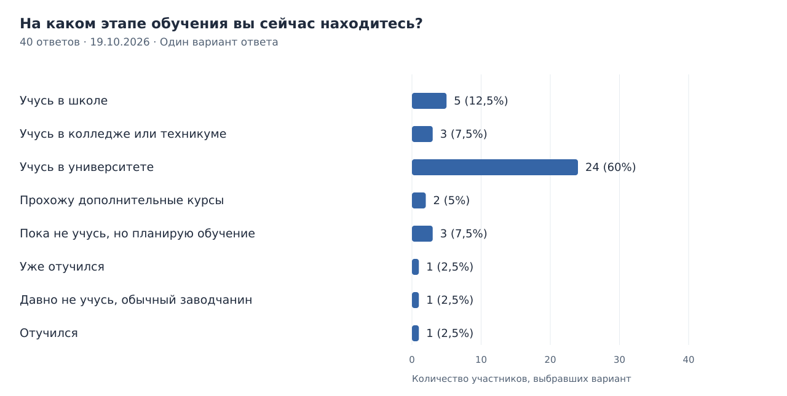
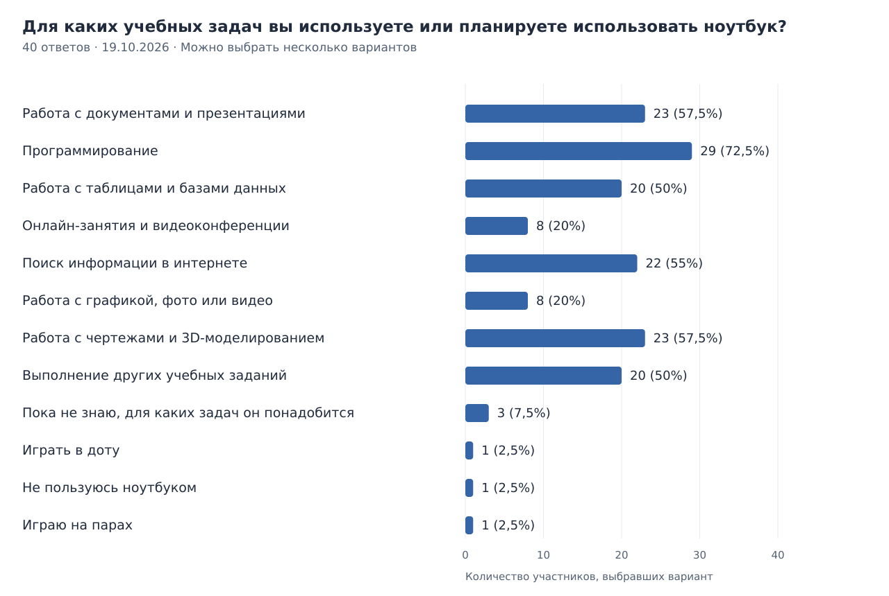
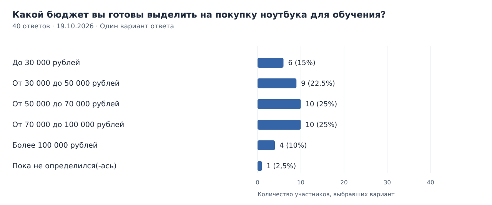
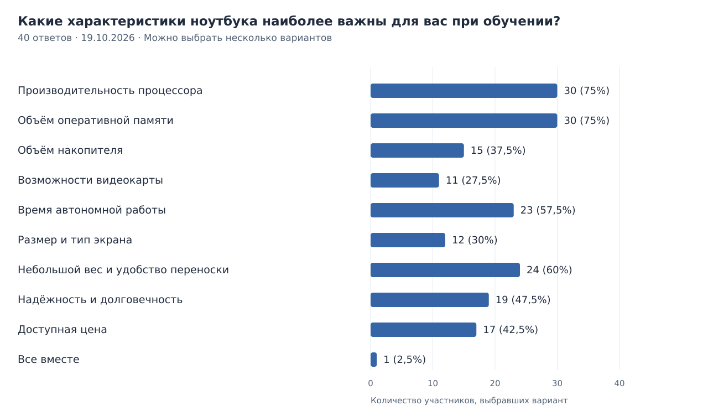
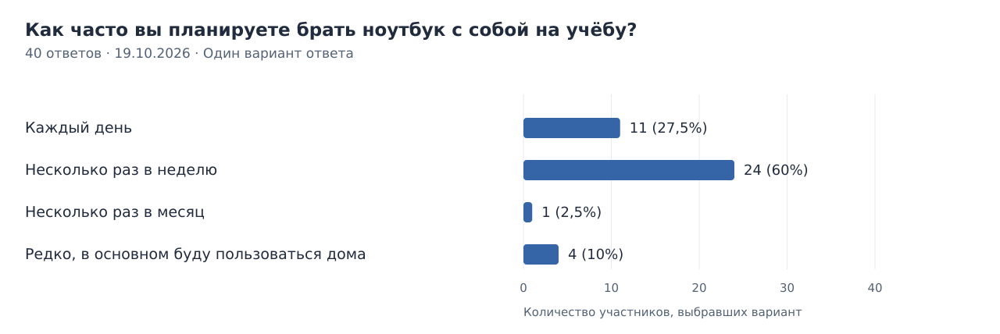
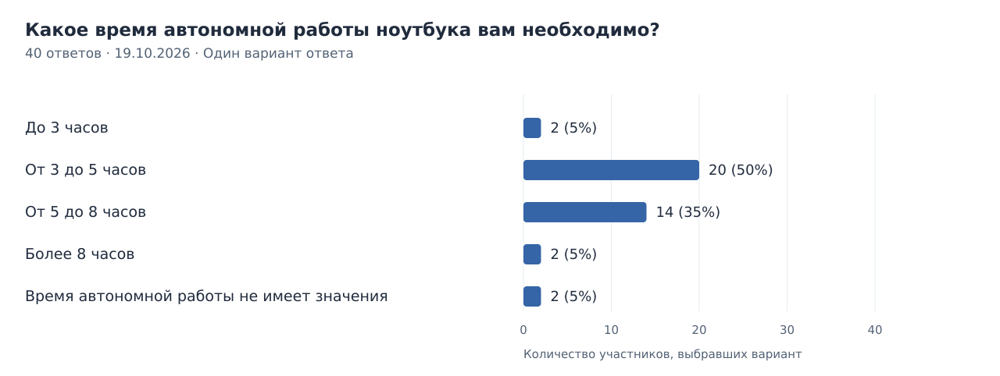
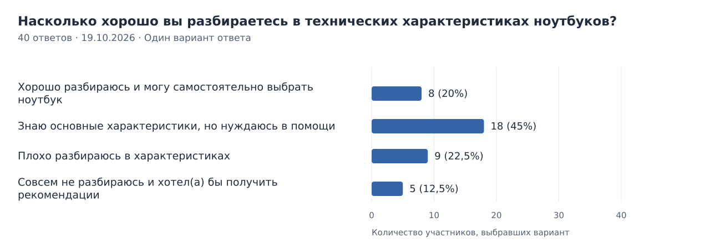
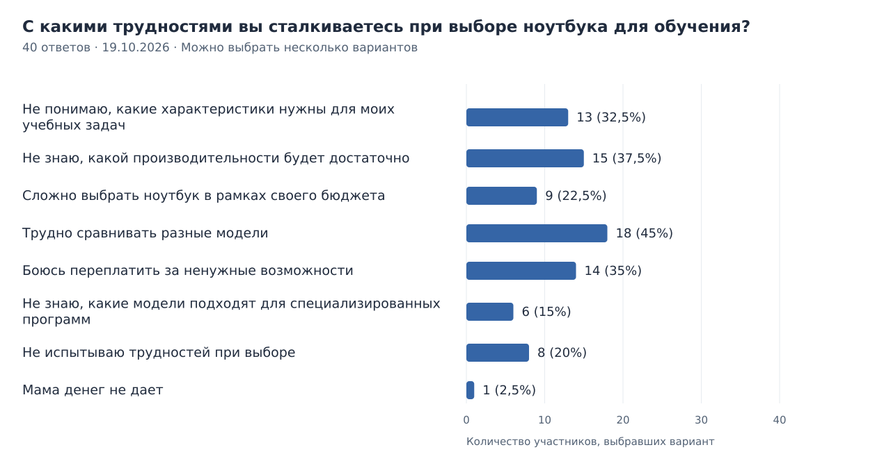
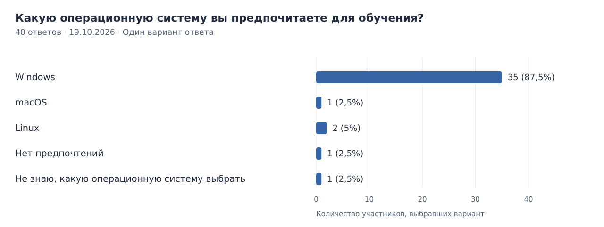
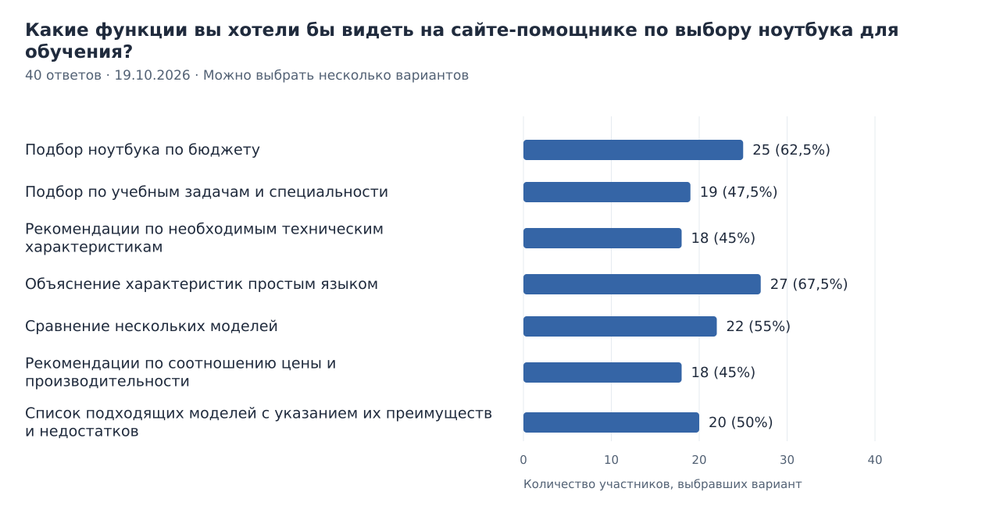

# Результаты опроса о выборе ноутбука для обучения

**Дата фиксации:** 19 октября 2026 года.  
**Количество ответов:** 40.  
**Источник:** сводка Google Формы «Исследование предпочтений пользователей при выборе ноутбука для обучения».

Во всех десяти вопросах получено по 40 ответов. Проценты рассчитаны от 40 участников. В вопросах с несколькими вариантами сумма процентов может быть больше 100%. Свободные варианты сохранены с исходными формулировками.

Диаграммы построены по сводке ответов Google Формы.

[Вернуться к отчёту](../report.md).

## 1. На каком этапе обучения вы сейчас находитесь?

**Тип вопроса:** один вариант ответа.

| Вариант ответа | Количество | Доля от 40 участников |
| --- | ---: | ---: |
| Учусь в школе | 5 | 12,5% |
| Учусь в колледже или техникуме | 3 | 7,5% |
| Учусь в университете | 24 | 60% |
| Прохожу дополнительные курсы | 2 | 5% |
| Пока не учусь, но планирую обучение | 3 | 7,5% |
| Уже отучился | 1 | 2,5% |
| Давно не учусь, обычный заводчанин | 1 | 2,5% |
| Отучился | 1 | 2,5% |

## 2. Для каких учебных задач вы используете или планируете использовать ноутбук?

**Тип вопроса:** несколько вариантов ответа.

| Вариант ответа | Количество | Доля от 40 участников |
| --- | ---: | ---: |
| Работа с документами и презентациями | 23 | 57,5% |
| Программирование | 29 | 72,5% |
| Работа с таблицами и базами данных | 20 | 50% |
| Онлайн-занятия и видеоконференции | 8 | 20% |
| Поиск информации в интернете | 22 | 55% |
| Работа с графикой, фото или видео | 8 | 20% |
| Работа с чертежами и 3D-моделированием | 23 | 57,5% |
| Выполнение других учебных заданий | 20 | 50% |
| Пока не знаю, для каких задач он понадобится | 3 | 7,5% |
| Играть в доту | 1 | 2,5% |
| Не пользуюсь ноутбуком | 1 | 2,5% |
| Играю на парах | 1 | 2,5% |

## 3. Какой бюджет вы готовы выделить на покупку ноутбука для обучения?

**Тип вопроса:** один вариант ответа.

| Вариант ответа | Количество | Доля от 40 участников |
| --- | ---: | ---: |
| До 30 000 рублей | 6 | 15% |
| От 30 000 до 50 000 рублей | 9 | 22,5% |
| От 50 000 до 70 000 рублей | 10 | 25% |
| От 70 000 до 100 000 рублей | 10 | 25% |
| Более 100 000 рублей | 4 | 10% |
| Пока не определился(-ась) | 1 | 2,5% |

## 4. Какие характеристики ноутбука наиболее важны для вас при обучении?

**Тип вопроса:** несколько вариантов ответа.

| Вариант ответа | Количество | Доля от 40 участников |
| --- | ---: | ---: |
| Производительность процессора | 30 | 75% |
| Объём оперативной памяти | 30 | 75% |
| Объём накопителя | 15 | 37,5% |
| Возможности видеокарты | 11 | 27,5% |
| Время автономной работы | 23 | 57,5% |
| Размер и тип экрана | 12 | 30% |
| Небольшой вес и удобство переноски | 24 | 60% |
| Надёжность и долговечность | 19 | 47,5% |
| Доступная цена | 17 | 42,5% |
| Все вместе | 1 | 2,5% |

## 5. Как часто вы планируете брать ноутбук с собой на учёбу?

**Тип вопроса:** один вариант ответа.

| Вариант ответа | Количество | Доля от 40 участников |
| --- | ---: | ---: |
| Каждый день | 11 | 27,5% |
| Несколько раз в неделю | 24 | 60% |
| Несколько раз в месяц | 1 | 2,5% |
| Редко, в основном буду пользоваться дома | 4 | 10% |

## 6. Какое время автономной работы ноутбука вам необходимо?

**Тип вопроса:** один вариант ответа.

| Вариант ответа | Количество | Доля от 40 участников |
| --- | ---: | ---: |
| До 3 часов | 2 | 5% |
| От 3 до 5 часов | 20 | 50% |
| От 5 до 8 часов | 14 | 35% |
| Более 8 часов | 2 | 5% |
| Время автономной работы не имеет значения | 2 | 5% |

## 7. Насколько хорошо вы разбираетесь в технических характеристиках ноутбуков?

**Тип вопроса:** один вариант ответа.

| Вариант ответа | Количество | Доля от 40 участников |
| --- | ---: | ---: |
| Хорошо разбираюсь и могу самостоятельно выбрать ноутбук | 8 | 20% |
| Знаю основные характеристики, но нуждаюсь в помощи | 18 | 45% |
| Плохо разбираюсь в характеристиках | 9 | 22,5% |
| Совсем не разбираюсь и хотел(а) бы получить рекомендации | 5 | 12,5% |

## 8. С какими трудностями вы сталкиваетесь при выборе ноутбука для обучения?

**Тип вопроса:** несколько вариантов ответа.

| Вариант ответа | Количество | Доля от 40 участников |
| --- | ---: | ---: |
| Не понимаю, какие характеристики нужны для моих учебных задач | 13 | 32,5% |
| Не знаю, какой производительности будет достаточно | 15 | 37,5% |
| Сложно выбрать ноутбук в рамках своего бюджета | 9 | 22,5% |
| Трудно сравнивать разные модели | 18 | 45% |
| Боюсь переплатить за ненужные возможности | 14 | 35% |
| Не знаю, какие модели подходят для специализированных программ | 6 | 15% |
| Не испытываю трудностей при выборе | 8 | 20% |
| Мама денег не дает | 1 | 2,5% |

## 9. Какую операционную систему вы предпочитаете для обучения?

**Тип вопроса:** один вариант ответа.

| Вариант ответа | Количество | Доля от 40 участников |
| --- | ---: | ---: |
| Windows | 35 | 87,5% |
| macOS | 1 | 2,5% |
| Linux | 2 | 5% |
| Нет предпочтений | 1 | 2,5% |
| Не знаю, какую операционную систему выбрать | 1 | 2,5% |

## 10. Какие функции вы хотели бы видеть на сайте-помощнике по выбору ноутбука для обучения?

**Тип вопроса:** несколько вариантов ответа.

| Вариант ответа | Количество | Доля от 40 участников |
| --- | ---: | ---: |
| Подбор ноутбука по бюджету | 25 | 62,5% |
| Подбор по учебным задачам и специальности | 19 | 47,5% |
| Рекомендации по необходимым техническим характеристикам | 18 | 45% |
| Объяснение характеристик простым языком | 27 | 67,5% |
| Сравнение нескольких моделей | 22 | 55% |
| Рекомендации по соотношению цены и производительности | 18 | 45% |
| Список подходящих моделей с указанием их преимуществ и недостатков | 20 | 50% |

