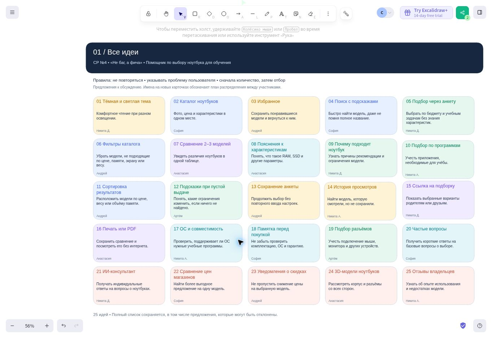
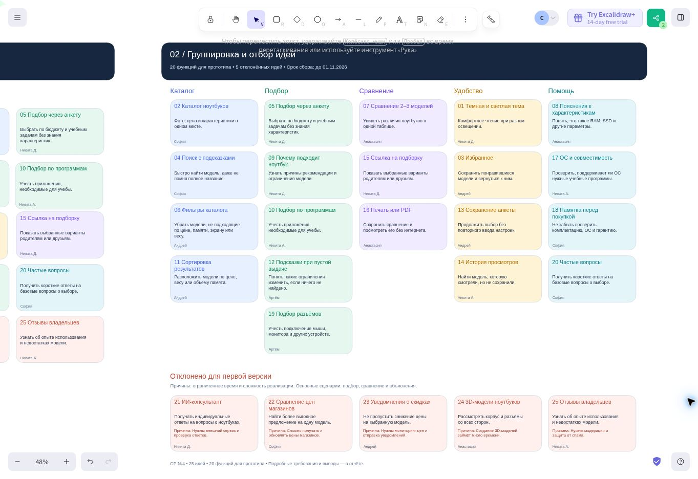

# Отчёт о самостоятельной работе № 4

## Выявление функциональных требований методом мозгового штурма

**Цель задания:** сформировать навыки выявления функций будущего продукта с помощью командного метода мозгового штурма.

**Команда:** «Не баг, а фича»  
**Бригада:** № 1  
**Проект:** «Помощник по выбору ноутбука для обучения»

## 1. Организация мозгового штурма

Сбор предложений организован в чате команды. Идеи оформлены на общей доске Excalidraw: отдельно сохранён полный список и отдельно показаны группировка и отбор.

**Состав команды:**

| Участник | Роль |
| --- | --- |
| Двойных Никита Константинович | Лидер команды |
| Алиева София Эльдаровна | Менеджер |
| Аванесова Анастасия Денисовна | Дизайнер UI/UX |
| Гришин Андрей Александрович | Программист |
| Аляпкин Никита Игоревич | Специалист по БД |
| Шушкин Артем Олегович | Тестировщик QA |

**Формат и длительность:** предложения собирались асинхронно, с перерывами, со сроком до **1 ноября 2026 года**. Точная продолжительность в часах не фиксировалась. Имена на новых карточках доски отражают распределение предложений для обсуждения.

**Правила:**

1. Не повторять уже предложенные идеи.
2. Для каждой идеи указывать проблему пользователя, которую она решает.
3. Сначала собрать как можно больше предложений, затем оценивать их качество.
4. На этапе генерации не критиковать предложения и сохранять все идеи, включая те, которые позже будут отклонены.

Основой стали потребности аудитории из [самостоятельной работы № 3](../practical-work-03/report.md). При отборе учитывались польза для студентов и родителей, связь с учебными задачами и возможность реализации в учебном прототипе.

[Общая доска](https://excalidraw.com/#room=fd8dc109b651ce31ddf3,5KZDTWPB00dRcM9328QZZQ) · [Файл доски для редактирования в Excalidraw](assets/brainstorm.excalidraw).

## 2. Полный список идей

| № | Идея | Какую проблему решает | Кто предложил |
| --- | --- | --- | --- |
| 1 | Тёмная и светлая тема | Помогает комфортно читать при разном освещении | Двойных Никита |
| 2 | Каталог ноутбуков | Собирает фотографии, цену, наличие, описание и характеристики в одном месте | Алиева София |
| 3 | Избранное | Позволяет сохранить понравившиеся модели и вернуться к ним | Гришин Андрей |
| 4 | Поиск с подсказками | Помогает найти модель, даже если пользователь не помнит её полное название | Алиева София |
| 5 | Подбор через анкету | Позволяет выбрать ноутбук по бюджету и учебным задачам без знания характеристик | Двойных Никита |
| 6 | Фильтры каталога | Убирают модели, не подходящие по цене, памяти, экрану или весу | Гришин Андрей |
| 7 | Сравнение двух или трёх моделей | Показывает отличия ноутбуков в одной таблице | Аванесова Анастасия |
| 8 | Пояснения к характеристикам | Объясняют простыми словами назначение процессора, ОЗУ, SSD и других параметров | Аванесова Анастасия |
| 9 | Объяснение рекомендации | Показывает, почему ноутбук подходит и какие у него ограничения | Двойных Никита |
| 10 | Подбор по учебным программам | Учитывает приложения, необходимые для обучения | Аляпкин Никита |
| 11 | Сортировка результатов | Располагает модели по цене, весу или объёму памяти | Гришин Андрей |
| 12 | Подсказки при отсутствии результатов | Объясняют, какие ограничения изменить, если подходящих моделей нет | Шушкин Артем |
| 13 | Сохранение анкеты и фильтров | Позволяет продолжить выбор без повторного ввода настроек | Гришин Андрей |
| 14 | История просмотров | Помогает найти модель, которую пользователь смотрел, но не сохранил | Аляпкин Никита |
| 15 | Ссылка на подборку или сравнение | Позволяет показать выбранные варианты родителям или друзьям | Двойных Никита |
| 16 | Печать или сохранение сравнения в PDF | Позволяет посмотреть результаты без интернета | Аванесова Анастасия |
| 17 | Информация об ОС и совместимости | Помогает проверить поддержку нужных учебных программ | Аляпкин Никита |
| 18 | Памятка перед покупкой | Напоминает проверить комплектацию, ОС, гарантию и комплект поставки | Алиева София |
| 19 | Подбор разъёмов | Учитывает подключение мыши, монитора и других устройств | Шушкин Артем |
| 20 | Частые вопросы | Даёт короткие ответы на базовые вопросы о выборе ноутбука | Алиева София |
| 21 | ИИ-консультант | Отвечает на индивидуальные вопросы пользователя | Двойных Никита |
| 22 | Автоматическое сравнение цен магазинов | Помогает найти более выгодное предложение на одну модель | Алиева София |
| 23 | Уведомления о снижении цены | Помогают не пропустить скидку на выбранную модель | Гришин Андрей |
| 24 | Интерактивные 3D-модели ноутбуков | Позволяют рассмотреть корпус со всех сторон | Аванесова Анастасия |
| 25 | Отзывы и оценки владельцев | Помогают узнать об опыте использования и недостатках моделей | Аляпкин Никита |

## 3. Группировка и отбор идей

Идеи распределены по задачам пользователя. Для прототипа выбраны предложения № 1–20. Предложения № 21–25 сохранены в общем списке, но не включены в первую версию.

| Группа | Номера идей | Обоснование выбора |
| --- | --- | --- |
| Каталог и поиск | 2, 4, 6, 11 | Позволяют найти модели и сократить список по нужным параметрам |
| Подбор | 5, 9, 10, 12, 19 | Связывают рекомендации с бюджетом, учебными задачами, программами и подключаемыми устройствами |
| Сравнение и передача результатов | 7, 15, 16 | Помогают оценить различия и обсудить покупку с другим человеком |
| Удобство использования | 1, 3, 13, 14 | Позволяют комфортно просматривать сайт и продолжать выбор после перерыва |
| Объяснения и помощь | 8, 17, 18, 20 | Снижают трудности из-за незнакомых терминов и помогают проверить важные условия покупки |

Сначала будут реализованы каталог, поиск, фильтры, анкета, сравнение и объяснение рекомендаций. Остальные выбранные функции дополняют эти сценарии. Для прототипа используется заранее подготовленный набор ноутбуков и правил подбора. Цены и наличие показываются с датой актуальности, без автоматического получения данных из магазинов.

| № | Отклонённая идея | Причина |
| --- | --- | --- |
| 21 | ИИ-консультант | Требует внешнего сервиса и проверки ответов. Для первой версии достаточно анкеты и подготовленных пояснений |
| 22 | Автоматическое сравнение цен магазинов | Получение и регулярное обновление данных нескольких магазинов усложняют проект |
| 23 | Уведомления о снижении цены | Требуют постоянного отслеживания цен и системы отправки уведомлений |
| 24 | Интерактивные 3D-модели | Подготовка моделей занимает много времени. Для выбора достаточно фотографий и характеристик |
| 25 | Отзывы и оценки владельцев | Требуют хранения отзывов, модерации и защиты от спама |

## 4. Функциональные требования

| Код | Требование | Идея |
| --- | --- | --- |
| ФТ-01 | Сайт должен позволять переключать светлую и тёмную тему | 1 |
| ФТ-02 | Сайт должен показывать каталог и карточки ноутбуков с фотографиями, названием, брендом, ценой, сведениями о наличии, описанием и основными характеристиками; для цены и наличия указывается дата актуальности | 2 |
| ФТ-03 | Пользователь должен иметь возможность добавлять модели в избранное, просматривать его и удалять сохранённые модели | 3 |
| ФТ-04 | Сайт должен искать ноутбуки по названию или бренду и показывать подсказки при вводе | 4 |
| ФТ-05 | Сайт должен принимать бюджет, учебные задачи, пожелания по переноске и автономности и показывать подходящие модели из каталога | 5 |
| ФТ-06 | Пользователь должен иметь возможность фильтровать каталог по цене, объёму ОЗУ и накопителя, диагонали экрана и весу | 6 |
| ФТ-07 | Пользователь должен иметь возможность выбрать две или три модели и сравнить их по одинаковому набору характеристик | 7 |
| ФТ-08 | Сайт должен показывать краткие пояснения технических характеристик по запросу пользователя | 8 |
| ФТ-09 | Для рекомендованной модели сайт должен показывать соответствие выбранным задачам и существенные ограничения | 9 |
| ФТ-10 | Сайт должен позволять выбрать учебные программы из подготовленного списка и учитывать заданные для них требования при подборе | 10 |
| ФТ-11 | Пользователь должен иметь возможность сортировать результаты по цене, весу и объёму памяти | 11 |
| ФТ-12 | При отсутствии подходящих моделей сайт должен сообщать об этом и предлагать изменить ограничения; модели за пределами бюджета не должны выдаваться как полностью подходящие | 12 |
| ФТ-13 | Сайт должен сохранять анкету и фильтры в текущем браузере и восстанавливать их при повторном открытии | 13 |
| ФТ-14 | Сайт должен показывать список недавно просмотренных моделей в текущем браузере | 14 |
| ФТ-15 | Пользователь должен иметь возможность скопировать ссылку, которая открывает выбранные модели подборки или сравнения | 15 |
| ФТ-16 | Сайт должен предоставлять печатную версию сравнения с возможностью сохранить её в PDF средствами браузера | 16 |
| ФТ-17 | Сайт должен показывать ОС ноутбука и сведения о совместимости с учебными программами из подготовленного списка | 17 |
| ФТ-18 | Сайт должен предоставлять памятку по проверке комплектации, ОС, гарантии и комплекта поставки перед покупкой | 18 |
| ФТ-19 | Пользователь должен иметь возможность отметить подключаемые устройства; сайт должен учитывать необходимые разъёмы и сообщать о возможной необходимости переходника | 19 |
| ФТ-20 | Сайт должен содержать раздел с короткими ответами на частые вопросы о выборе ноутбука | 20 |

## 5. Вывод

Составлен список из 25 идей. Для прототипа выбраны 20 функций, пять предложений отклонены из-за сложности реализации и ограниченного времени.

Требования связаны с потребностями аудитории из работы № 3. В опросе 40 человек простые объяснения выбрали 27 участников (67,5%), подбор по бюджету выбрали 25 (62,5%), сравнение моделей выбрали 22 (55%). Поэтому основными сценариями станут подбор под бюджет и учебные задачи, сравнение моделей и понятное объяснение выбора. Избранное, сохранение настроек и передача подборки помогут продолжать выбор и обсуждать покупку с родителями.

Сформулированные требования будут использованы при проектировании интерфейса и разработке прототипа.

## 6. Ответы на контрольные вопросы

**1. Что такое мозговой штурм и каковы его основные правила?**

Мозговой штурм: способ совместно собрать идеи для решения задачи. Сначала участники предлагают варианты без критики, фиксируют все предложения и могут развивать чужие идеи. После этого идеи группируют, обсуждают и отбирают.

**2. Почему на этапе генерации идей критика запрещена?**

Критика может остановить обсуждение и заставить участников отказаться от предложений. Свободное высказывание помогает собрать больше вариантов, в том числе необычных. Оценка проводится на следующем этапе.

**3. Что такое функциональное требование?**

Это описание действия, которое должна выполнять система. Например, сайт должен позволять выбрать две или три модели ноутбуков и сравнить их характеристики в одной таблице.

**4. Как связаны целевая аудитория и функциональные требования?**

Требования определяются задачами и проблемами пользователей. Нашей аудитории сложно сравнивать модели и понимать характеристики, поэтому сайту нужны сравнение, простые пояснения и подбор по бюджету и учебным задачам.

**5. Зачем фиксировать все идеи, даже «неудачные»?**

Это сохраняет результаты обсуждения и позволяет объяснить отбор. Отложенная идея может пригодиться позже или стать основой другого решения. Поэтому отклонённые предложения остаются в общем списке вместе с причинами отказа.
