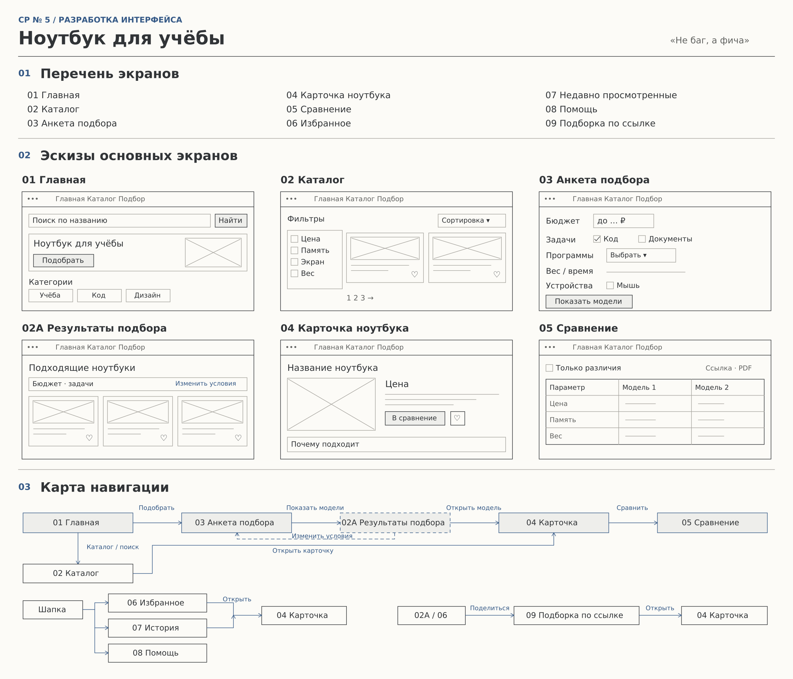
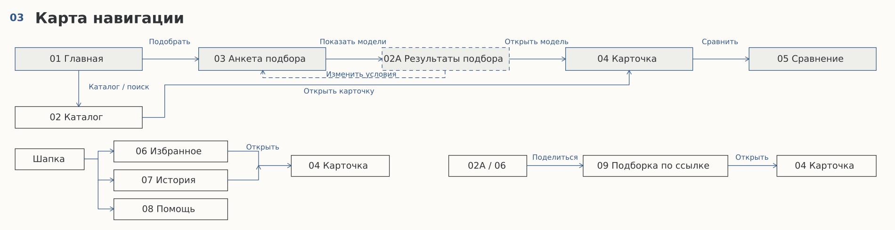

# Отчёт о самостоятельной работе № 5

## Разработка интерфейса

**Цель работы:** сформировать начальные навыки проектирования пользовательского интерфейса на основе выявленных функциональных требований.

**Команда:** «Не баг, а фича»  
**Бригада:** № 1  
**Проект:** «Помощник по выбору ноутбука для обучения»  
**Дисциплина:** «Введение в профессиональную деятельность»

## 1. Перечень экранов

В [работе № 3](../practical-work-03/report.md) определили целевую аудиторию проекта, а в [работе № 4](../practical-work-04/report.md) составили функциональные требования. На их основе спроектировали два способа начать выбор: открыть каталог и настроить фильтры или заполнить анкету и получить подборку.

| № | Экран | Назначение |
| --- | --- | --- |
| 01 | Главная | Начать подбор, открыть нужную категорию каталога или найти знакомую модель по названию или бренду. |
| 02 | Каталог | Просматривать модели и сужать список по цене, памяти, размеру экрана, весу и другим параметрам. |
| 03 | Анкета подбора | Задать бюджет, учебные задачи, программы, пожелания по весу и автономности и указать подключаемые устройства. |
| 04 | Карточка ноутбука | Посмотреть сведения о модели, оценить её пригодность для своих задач, сохранить модель или добавить к сравнению. |
| 05 | Сравнение | Сопоставить две или три модели по одинаковым параметрам и увидеть различия. |
| 06 | Избранное | Просмотреть или убрать сохранённые модели, вернуться к их карточкам и поделиться подборкой. |
| 07 | Недавно просмотренные | Вернуться к ранее открытым моделям без повторного поиска. |
| 08 | Помощь | Разобраться в частых вопросах и проверить, что нужно уточнить перед покупкой. |
| 09 | Подборка по ссылке | Открыть список, которым поделился другой человек, и посмотреть карточки моделей из него. |

На макетах и карте также обозначено состояние **02А «Результаты подбора»**. Оно использует тот же каталог, но показывает только модели, которые соответствуют условиям анкеты. Это отдельный макет, но не дополнительная страница.

## 2. Эскизы и элементы основных экранов

На доске собраны шесть эскизов. Они показывают, где находятся основные элементы: поля, кнопки, фильтры, карточки и таблица. Прямоугольники с крестом обозначают места для изображений ноутбуков.

[Файл доски для редактирования в Excalidraw](assets/sr5-interface.excalidraw).

| Эскиз | Элементы и их назначение |
| --- | --- |
| **01. Главная** | Поиск помогает найти модель по названию или бренду. Кнопка «Подобрать» открывает анкету. Категории «Учёба», «Код» и «Дизайн» ведут к нужной части каталога. |
| **02. Каталог** | Фильтры слева задают ограничения, а список сортировки над карточками меняет порядок моделей. В карточке предусмотрено место для изображения, названия, цены и кратких характеристик. По нажатию на карточку открывается страница модели. Сердечко сохраняет её в избранное. |
| **03. Анкета подбора** | Сначала пользователь задаёт максимальный бюджет. Затем отмечает задачи, выбирает программы, указывает ограничения по весу и времени работы без зарядки и выбирает подключаемые устройства. Кнопка «Показать модели» открывает выдачу. |
| **02А. Результаты подбора** | Над карточками видны условия, по которым составлен список. Кнопка «Изменить условия» возвращает к заполненной анкете. Если совпадений нет, выдача объясняет, что можно изменить, например бюджет или ограничение по весу. |
| **04. Карточка ноутбука** | В карточке предусмотрены изображение, цена и основные характеристики. В подробной части планируется показать описание, ОС, совместимость с учебными программами, разъёмы и сведения о наличии. Для цены и наличия предусмотрена дата актуальности. Блок «Почему подходит» объясняет рекомендацию, а кнопки помогают сохранить модель или добавить её в сравнение. |
| **05. Сравнение** | В строках таблицы стоят характеристики, в столбцах — выбранные модели. Переключатель «Только различия» скрывает одинаковые значения. Сравнение можно открыть по ссылке или сохранить в PDF через печать браузера. |

## 3. Карта навигации

**Подбор через анкету.** С главной страницы пользователь нажимает «Подобрать», указывает условия и получает результаты. Он открывает карточку, добавляет модель в сравнение и выбирает ещё одну или две модели. После этого открывает таблицу сравнения. Чтобы уточнить выдачу, он может вернуться к анкете через «Изменить условия».

**Поиск через каталог.** Пользователь открывает каталог из меню или попадает в него после поиска. Он выбирает фильтры, открывает подходящую модель или добавляет несколько моделей к сравнению прямо из списка. Добавление модели отмечает её в списке; таблица открывается отдельным действием.

**Возврат к выбору и передача результатов.** Из шапки сайта можно открыть избранное, недавно просмотренные модели или помощь. Из избранного и истории пользователь возвращается к карточке. Ссылку на результаты или избранное можно передать другому человеку: у него откроется экран 09 с выбранным списком. Ссылка на сравнение открывает экран 05 с теми же моделями.

## 4. Связь с функциональными требованиями

| Код | Где учтено требование |
| --- | --- |
| ФТ-01 | В шапке предусмотрен переключатель светлой и тёмной темы. |
| ФТ-02 | В каталоге и карточке предусмотрены изображения, название, бренд, описание, цена, наличие и характеристики. У цены и наличия указывается дата актуальности. |
| ФТ-03 | Сердечко сохраняет модель; на экране 06 её можно открыть или убрать из списка. |
| ФТ-04 | Поиск в шапке принимает название или бренд и показывает подсказки при вводе; выдача открывается в каталоге. |
| ФТ-05 | Анкета передаёт бюджет, учебные задачи, вес и автономность в подбор; результат отображается на экране 02А. |
| ФТ-06 | Панель каталога содержит фильтры по цене, оперативной памяти, накопителю, размеру экрана и весу. |
| ФТ-07 | Модели отмечаются в каталоге или карточке. Экран 05 сопоставляет две или три модели по одним и тем же параметрам. |
| ФТ-08 | Значки «?» рядом с характеристиками открывают короткие пояснения. На экране 08 также доступны ответы на базовые вопросы. |
| ФТ-09 | В карточке блок «Почему подходит» показывает, каким задачам отвечает модель и какие у неё ограничения. |
| ФТ-10 | В анкете можно выбрать программы из списка; их требования участвуют в подборе. |
| ФТ-11 | Над выдачей находится сортировка по цене, весу и объёму памяти. |
| ФТ-12 | При пустой выдаче показывается сообщение с предложением изменить условия. Модели дороже бюджета не отмечаются как подходящие. |
| ФТ-13 | Предусмотрено сохранение анкеты и фильтров в текущем браузере, чтобы можно было продолжить выбор после перерыва. |
| ФТ-14 | На экране 07 отображается история открытых карточек в текущем браузере. |
| ФТ-15 | Ссылку на подборку или сравнение можно скопировать; у получателя откроются выбранные модели. |
| ФТ-16 | На экране 05 предусмотрена печатная версия таблицы с возможностью сохранить её в PDF. |
| ФТ-17 | В карточке показываются ОС и сведения о совместимости с учебными программами из списка. |
| ФТ-18 | В помощи есть памятка по проверке комплектации, ОС, гарантии и комплекта поставки. |
| ФТ-19 | В анкете отмечаются устройства, а в карточке показываются нужные разъёмы и предупреждение, если может понадобиться переходник. |
| ФТ-20 | Экран 08 содержит краткие ответы на частые вопросы о выборе ноутбука. |

Эскизы показывают расположение основных элементов. Дополнительные элементы и состояния, которые не вынесены на отдельный эскиз, зафиксированы в таблице для следующего этапа.

## 5. Обоснование решений

В [опросе из работы № 3](../practical-work-03/report.md) участвовали 40 человек. По его результатам выделили три решения:

| Что показал опрос | Как это учли в интерфейсе |
| --- | --- |
| 27 человек (67,5%) выбрали простые объяснения. | Краткие пояснения размещены рядом с характеристиками. В карточке отдельно показано, для каких задач подходит модель. |
| 25 человек (62,5%) выбрали подбор по бюджету. | Бюджет вынесен в начало анкеты; ограничение видно и на странице с результатами. Если моделей нет, условия можно изменить. |
| 22 человека (55%) выбрали сравнение моделей. | Характеристики расположены в одинаковых строках таблицы, чтобы пользователю не приходилось переключаться между карточками. |

Студентам технических направлений важно проверить, запустятся ли программы для программирования, расчётов и чертежей. Поэтому в анкете есть выбор программ, а в карточке — сведения о совместимости. Для студентов творческих направлений важны параметры экрана и графики: их можно посмотреть в карточке и сравнить между моделями. Родителям проще обсудить варианты, если есть ссылка на готовый список и памятка о том, что уточнить у продавца.

## 6. Вывод

В работе определили девять страниц сайта и подготовили шесть эскизов, включая отдельный вид результатов подбора. На карте показали основной маршрут от главной страницы до сравнения и дополнительные переходы через каталог, избранное, историю и общую ссылку. По эскизам видно, где пользователь задаёт условия, получает объяснение и сравнивает модели. Эти материалы будут использованы при разработке прототипа.

## 7. Ответы на контрольные вопросы

**1. Что такое пользовательский интерфейс?**

Это экраны и элементы, через которые человек взаимодействует с программой: формы, кнопки, меню и сообщения. В нашем проекте пользователь через интерфейс задаёт условия подбора, открывает модели и сравнивает их.

**2. Какими качествами должен обладать удобный интерфейс?**

Он должен быть понятным, читаемым и последовательным. Пользователь должен видеть, где он находится и что произойдёт после нажатия. Одинаковые действия лучше обозначать одинаковыми подписями или значками, а сообщения об ошибках должны подсказывать, что сделать дальше.

**3. Что такое макет (эскиз) экрана и зачем он нужен?**

Эскиз показывает расположение главных элементов будущего экрана: например, где будут фильтры, карточки и кнопки. Его делают до программирования, чтобы согласовать структуру и исправить ошибки в компоновке без переделки работающего сайта.

**4. Что такое навигация в интерфейсе?**

Навигация — это переходы между страницами и разделами через меню, ссылки и кнопки. Например, в нашей анкете кнопка «Показать модели» открывает результаты, а «Изменить условия» возвращает к анкете.

**5. Как потребности целевой аудитории влияют на дизайн интерфейса?**

От задач аудитории зависит, что нужно показать первым и какие действия должны быть доступны с экрана. В нашем проекте бюджет стоит в начале анкеты, технические термины поясняются, а модели сравниваются в одной таблице.
